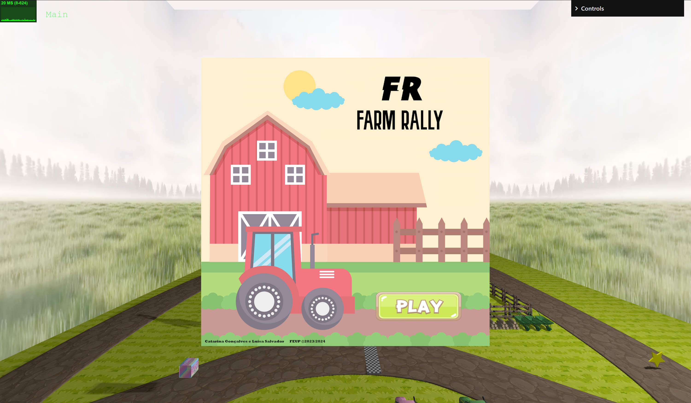
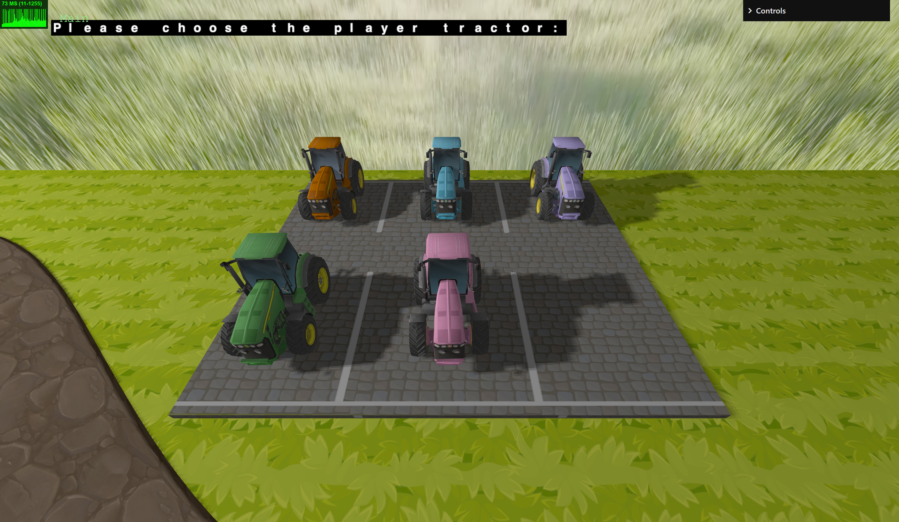
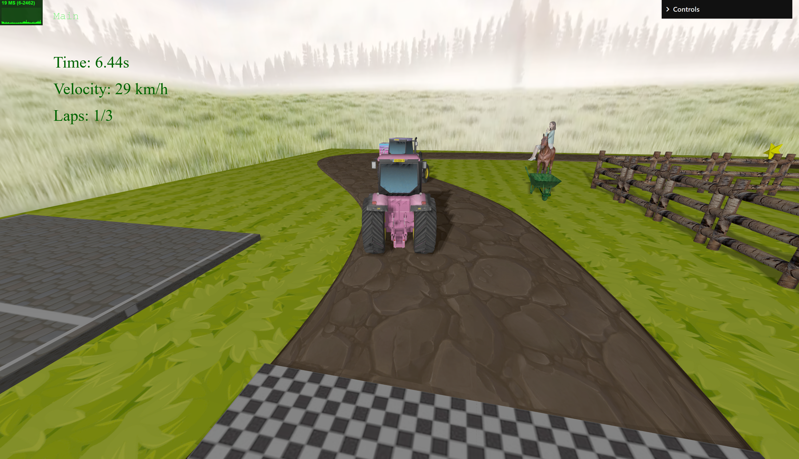
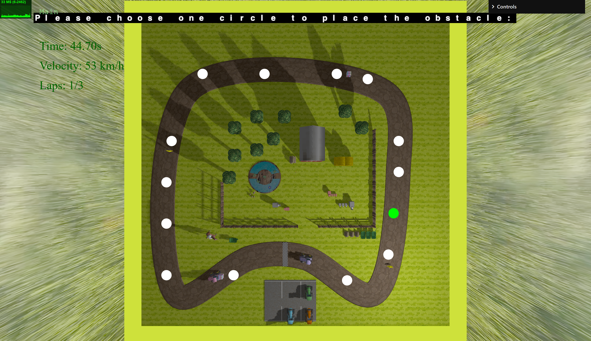
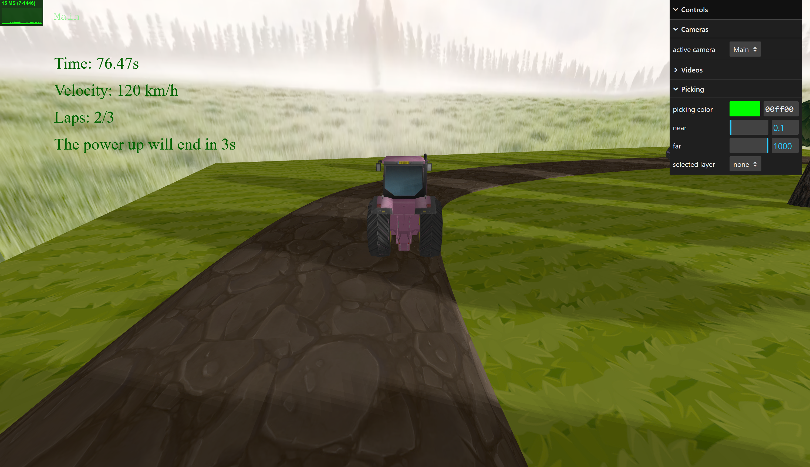
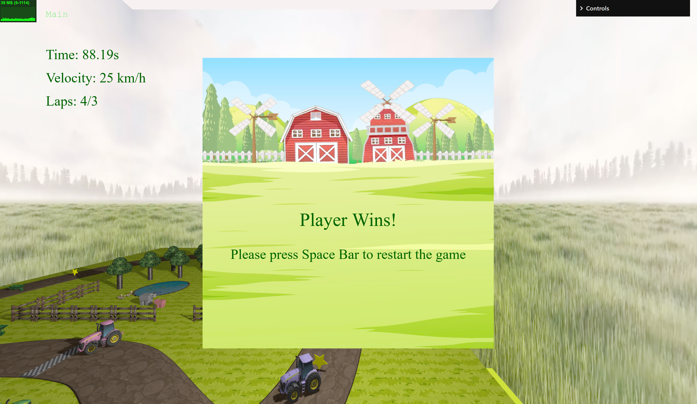

# SGI 2023/2024 - TP3

## Group: T06G10

| Name             | Number    | E-Mail             |
| ---------------- | --------- | ------------------ |
| Catarina Gonçalves | 201906638 | up201906638@fc.up.pt                |
| Luísa Salvador   | 202006471 | up202006471@fe.up.pt                |

----
## Project information

- We worked on our creativity to create a farm race scene, with detailed tractors, animals with model3D, hay with wireframes, lake with nurbs,...
- We have tractors using WASD keys, complete with rotating wheels and maximum speed. We also implemented power-ups, obstacles, outdoor displays, picking interactions, key animation and collision detection. 
- Our interface uses spritesheets to enhance text visuals, and a user-friendly menu for a captivating gaming experience.

## Issues/Problems

- Due to time constraints, shader implementations were not incorporated into the project.

## Screenshots

